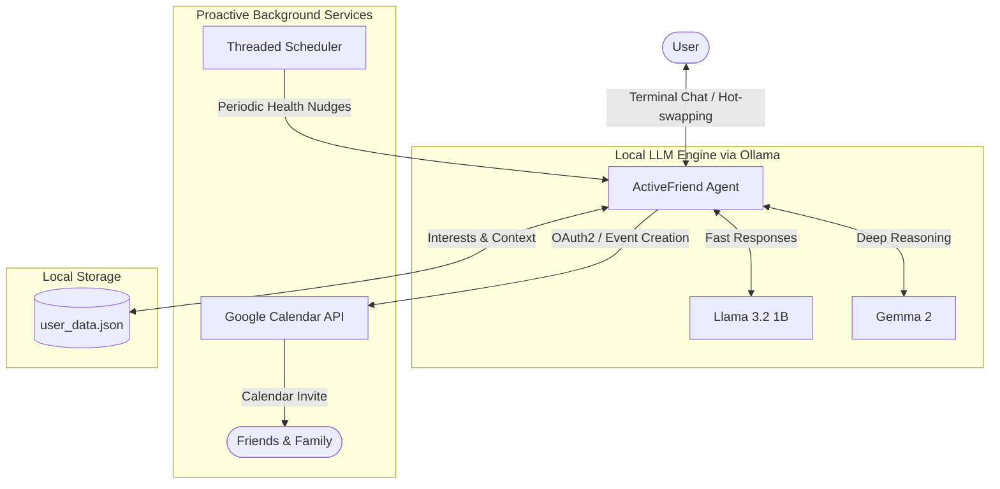

# 🌟 Active Friend AI - Proactive Mental Health & Social Companion

> **An empathetic, privacy-first AI companion that watches out for your mental health, keeps you from burning out in front of screens, and actively helps you stay connected with real-world friends.**

---

## 💡 Inspiration & Purpose

In modern tech and remote work cultures, developers and students spend long, unbroken hours staring at screens. Burnout, social isolation, and screen fatigue creep in unnoticed. Traditional AI assistants are purely **reactive**—they wait for you to prompt them and often keep you glued to your screen longer.

**Active Friend AI** is designed to be **proactive**:
- 🧘 **Monitors & Intervenes**: Nudges you to hydrate, stretch, and step away when screen time gets excessive.
- 🤝 **Bridges the Real World**: Encourages you to socialize and uses Google Calendar to schedule coffee and breaks with friends.
- 🧠 **Dual-Model Reasoning**: Leverages local models (`llama3.2:1b` for lightning-fast daily banter and `gemma2` for deep emotional support, reasoning, and goal planning).
- 🔒 **100% Local & Private**: Your mental health conversations and personal data stay strictly on your local machine via Ollama.

---

## ✨ Key Features

1. **🧠 Gemma 2 Advanced Cognitive Reasoning & Mental Stability Support**
   - Specially calibrated for complicated mental distress, anxiety spirals, burnout, and emotional dysregulation.
   - Applies structured psychological reasoning: validates emotions, deconstructs cognitive distortions (catastrophizing, all-or-nothing thinking), provides dialectical reframing, and recommends low-friction micro-actions.
2. **🌿 Somatic Grounding & Crisis Safety Net**
   - Built-in interactive grounding (`/ground`) implementing 5-4-3-2-1 sensory anchoring to stabilize the autonomic nervous system.
   - Automatic crisis keyword detection and instant access to 24/7 confidential helplines (`/crisis` - 988, Crisis Text Line 741741, International).
3. **⚡ Dynamic Model & Persona Switching (`/switch`, `/reason`, `/fast`)**
   - Seamlessly toggle between `llama3.2:1b` (high-speed daily banter, quick checks) and `gemma2` (deep cognitive reasoning, emotional untangling) mid-conversation while updating system prompts dynamically.
4. **⏰ Proactive Break & Screen-Time Management**
   - Background scheduler checks activity intervals and reminds you to hydrate, stretch, and step away before screen fatigue sets in.
5. **📅 Real-Life Meetup Scheduling (Google Calendar)**
   - Integrates with the Google Calendar API to automatically organize hangouts, invite friends via email, and block out social recharge time.
6. **💾 Long-Term Memory & User Profile**
   - Persists your interests, goals, and friend list in `user_data.json`, ensuring personalized, context-aware motivation tailored to who you are.

---

## 🏗️ Architecture & How It Works



---

## 🛠️ Tech Stack

- **Language:** Python 3.10+
- **LLM Runtime:** [Ollama](https://ollama.ai) running `llama3.2:1b` and `gemma2`
- **Scheduling:** `schedule` & Python threading
- **System Monitoring:** `psutil`, `pygetwindow`
- **Calendar & Auth:** `google-api-python-client`, `google-auth-oauthlib`

---

## 🚀 Getting Started

### 1. Prerequisites
- Install [Python 3.10+](https://www.python.org/downloads/)
- Install [Ollama](https://ollama.ai) and pull the local models:
  ```powershell
  ollama pull llama3.2:1b
  ollama pull gemma2
  ```

### 2. Installation
Clone the repository and install the dependencies:
```powershell
git clone https://github.com/<your-username>/hacktober-fest-projects.git
cd hacktober-fest-projects
pip install -r requirements.txt
```

### 3. Google Calendar Setup (Optional for Meetup Scheduling)
To enable automated Google Calendar meetup scheduling:
1. Visit the [Google Cloud Console](https://console.cloud.google.com/).
2. Create a new project and enable the **Google Calendar API**.
3. Under **Credentials**, create an **OAuth 2.0 Client ID** (Application Type: *Desktop App*).
4. Download the client secret JSON file, rename it to `credentials.json`, and place it in the root folder.
5. Run the authentication script once to generate your token:
   ```powershell
   python google_calendar_utils.py
   ```

---

## 🎮 Usage

Launch your companion in default mode (Llama 3.2 1B for quick banter):
```powershell
python active_friend.py
```

Or start directly in **Gemma 2 Deep Cognitive Reasoning & Mental Stability mode**:
```powershell
python active_friend.py --reason
# or explicitly specify the model:
python active_friend.py --model gemma2
```

### In-Chat Commands
- **Chat naturally**: Share what's on your mind, ask for advice, work through emotional spirals, or vent.
- **`/reason` or `/deep`**: Engage Gemma 2's deep cognitive reasoning mode to untangle knotty thoughts and complex emotional distress.
- **`/fast` or `/chat`**: Switch back to Llama 3.2 1B for quick check-ins, reminders, and daily banter.
- **`/switch`**: Instantly toggle between Llama 3.2 1B and Gemma 2 while dynamically updating system prompts.
- **`/ground`**: Trigger an interactive 5-4-3-2-1 somatic grounding exercise to stabilize acute panic or overwhelm.
- **`/crisis`**: Immediately display 24/7 confidential crisis hotlines and resources (988, Crisis Text Line 741741, International).
- **`/status`**: Display the active model, cognitive mode, and user context.
- **`schedule meetup`**: Prompts for a friend's details to schedule a hangout on Google Calendar.
- **`quit` / `exit`**: Closes the companion session safely.

---

## 📂 Project Structure

```text
├── active_friend.py          # Core companion agent & conversation loop
├── google_calendar_utils.py  # Google Calendar API authentication & event dispatcher
├── user_data.json            # Local persistent user profile, interests, and preferences
├── requirements.txt          # Python dependencies
└── README.md                 # Project documentation
```

---

## 🎃 Hacktoberfest & Open Source Contributions

Contributions are welcome! Here are a few ways you can help enhance Active Friend AI:
- [ ] Add Windows toast notifications (`win10toast` / `plyer`) for non-intrusive desktop alerts.
- [ ] Integrate voice input/output (STT/TTS using Whisper or Piper).
- [ ] Build a lightweight system tray interface.
- [ ] Add sentiment analysis to track mood trends over time.

Feel free to fork the repository, open issues, and submit Pull Requests!

---

## ⚠️ Important Safety & Ethical Notice

> **Active Friend AI is an open-source, peer-support companion and cognitive grounding tool. It is NOT a licensed therapist, psychiatrist, or medical service.**
>
> If you or someone you know is struggling with thoughts of self-harm, severe psychiatric crisis, or immediate danger, please reach out immediately to professional human support:
> - **United States & Canada:** Call or text **988** ([988 Lifeline](https://988lifeline.org/))
> - **Crisis Text Line:** Text `HOME` to **741741** (US & Canada) or **85258** (UK)
> - **United Kingdom:** Call **111** (NHS Mental Health) or **116 123** (Samaritans)
> - **International:** Find verified local hotlines at [findahelpline.com](https://findahelpline.com/) or [befrienders.org](https://www.befrienders.org/)

---

## 📄 License

This project is open-source and licensed under the [MIT License](LICENSE).
